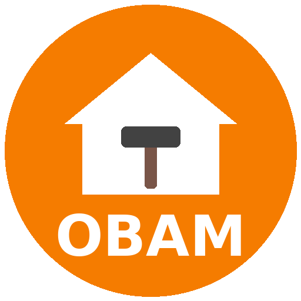
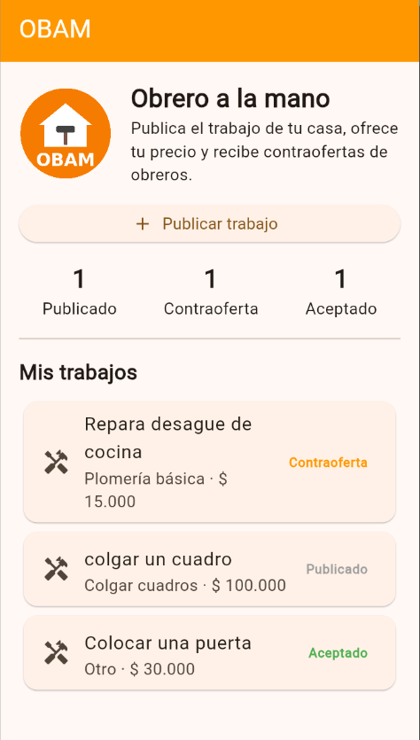
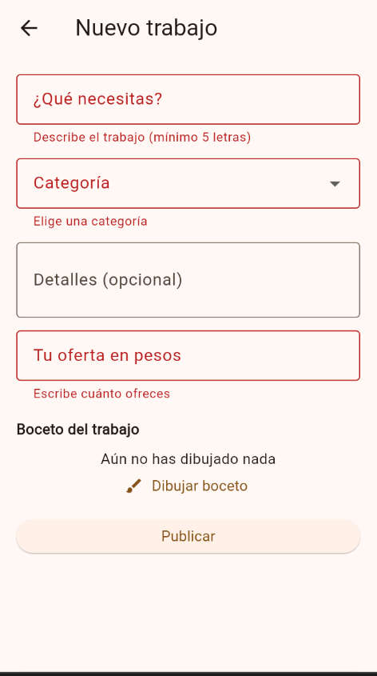
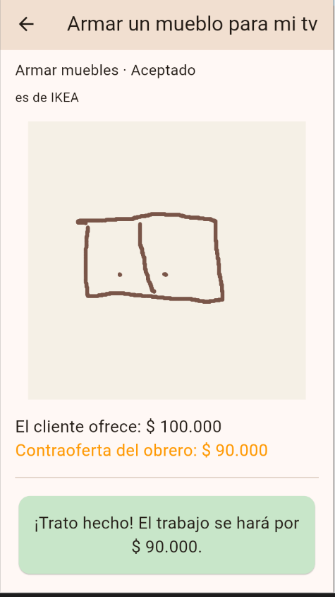
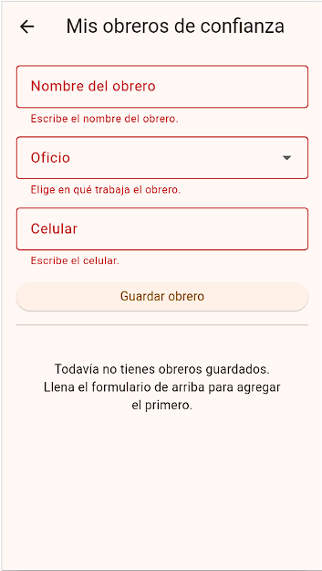
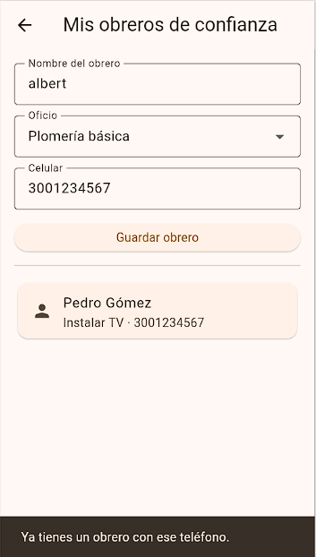

# Ficha de aplicación — OBAM · Obrero a la mano

Propuesta simulada de ficha para publicación en **Google Play Store** (Taller final · ET0126 · I.U. Pascual Bravo).  
Todo lo descrito en este documento corresponde exclusivamente a lo que la aplicación hace realmente en su versión actual.

---

## 1. Nombre y categoría propuesta

- **Nombre de la aplicación:** OBAM · Obrero a la mano
- **Categoría propuesta en Google Play:** Casa y hogar (*House & Home*)
- **Etiquetas sugeridas:** arreglos del hogar, mantenimiento, reparaciones, cotización, servicios domésticos

---

## 2. Descripción corta

> Publica arreglos del hogar con boceto, ofrece tu precio y negocia en minutos.

*(77 caracteres — cumple el límite de 80 caracteres de Google Play).*

---

## 3. Descripción completa

¿Necesitas colgar un cuadro, instalar un televisor, armar un mueble o resolver un arreglo pequeño en casa, pero no sabes cuánto pagar ni cómo explicar exactamente qué necesitas?

**OBAM (Obrero a la mano)** te ayuda a organizar y negociar arreglos pequeños del hogar de forma simple, inspirada en el modelo de oferta y contraoferta:

- **Acceso con cuenta:** inicia sesión con tu correo y contraseña o continúa directamente con tu cuenta de **Google** mediante Firebase Authentication.
- **Publica tu trabajo con tu oferta:** escribe qué necesitas, elige una categoría (*Colgar cuadros, Instalar TV, Armar muebles, Plomería básica, Electricidad básica u Otro*), agrega detalles opcionales y propón el precio que estás dispuesto a pagar (desde \$ 10.000 COP).
- **Explica con un boceto a mano alzada:** en lugar de tomar fotos, dibuja directamente con el dedo en un lienzo dónde va el cuadro, el televisor o el mueble para que el trabajo quede claro desde el inicio.
- **Negocia con contraofertas:** revisa el detalle de cada requerimiento, simula una contraoferta en pasos de \$ 5.000 COP y decide si **aceptar** el trato o **rechazar** la propuesta.
- **Controla tus estados y guarda tus trabajos:** consulta desde el inicio cuántos trabajos tienes en estado *Publicado*, *Contraoferta* y *Aceptado*, con guardado local automático en tu teléfono.
- **Mis obreros de confianza:** guarda en tu sesión actual el nombre, oficio y celular (formato colombiano de 10 dígitos) de los obreros que ya te hicieron un buen trabajo, evitando registros duplicados por teléfono.

---

## 4. Público objetivo

- **Propietarios, arrendatarios y familias en Colombia** (20 a 55 años) que necesitan resolver arreglos domésticos puntuales y prefieren proponer su presupuesto y dejar claro qué requieren mediante un dibujo rápido.
- **Por qué les resulta útil:** reduce la incertidumbre sobre cuánto cobrar o pagar por trabajos pequeños, reemplaza explicaciones largas por un boceto visual directo y permite llevar un control simple de sus solicitudes y contactos de confianza.

---

## 5. Ícono propuesto y capturas reales

### Ícono de la aplicación

*Ícono circular naranja con silueta de casa y martillo, representando arreglos rápidos del hogar.*

### Capturas reales de la aplicación

| Pantalla de inicio y resumen | Validación de nuevo trabajo | Detalle con boceto y trato cerrado |
| :---: | :---: | :---: |
|  |  |  |
| **Inicio:** muestra el resumen de trabajos por estado (*Publicado*, *Contraoferta*, *Aceptado*) y la lista persistida en el dispositivo. | **Nuevo trabajo:** valida descripción mínima, categoría y oferta en pesos (mínimo \$ 10.000) antes de publicar. | **Detalle y negociación:** renderiza el boceto dibujado en Canvas junto con la oferta, la contraoferta y la confirmación del trato. |

| Validación en obreros de confianza | Regla de negocio: celular duplicado |
| :---: | :---: |
|  |  |
| **Validación de campos:** exige nombre de al menos 3 letras, oficio y celular colombiano de 10 dígitos que inicie en `3`. | **Control de duplicados:** impide registrar dos obreros con el mismo número de teléfono y muestra el aviso sin borrar lo escrito. |

> **Nota sobre capturas de autenticación:** la pantalla de acceso con Firebase (`LoginScreen`: correo/contraseña, botón **Continuar con Google**, manejo de credenciales inválidas y cierre de sesión) se demuestra en vivo en la exposición y en la APK `entrega/app.apk`.

---

## 6. Datos y permisos

### Datos que maneja la aplicación

| Dato | Dónde se guarda | Para qué se usa |
| --- | --- | --- |
| Correo electrónico, nombre visible y `uid` de cuenta | **Firebase Authentication** (Google) | Autenticar al usuario (correo/contraseña o Google), mantener la sesión activa y mostrar el usuario en pantalla. |
| Trabajos publicados (título, categoría, descripción, oferta, contraoferta, estado y puntos del boceto) | **Localmente en el dispositivo** (`SharedPreferences`, formato JSON) | Mantener la lista de trabajos del usuario al cerrar y volver a abrir la app. No se envía a servidores propios. |
| Obreros de confianza (nombre, oficio, celular) | **Memoria RAM del dispositivo** (temporal) | Permitir registrar y validar contactos durante la sesión actual; se borran al cerrar la aplicación. |

### Permisos de Android solicitados

- **`android.permission.INTERNET`:** requerido exclusivamente para comunicarse con **Firebase Authentication** y **Google Sign-In** al iniciar y cerrar sesión.
- La app **no solicita** permisos de cámara, ubicación GPS, micrófono, agenda de contactos ni lectura de archivos externos.

---

## 7. Política de privacidad propuesta

Esta propuesta describe de forma transparente cómo se tratan los datos en la versión actual de **OBAM**:

1. **Qué datos recogemos:** únicamente la información de identidad necesaria para iniciar sesión mediante **Firebase Authentication** (correo electrónico, nombre público si eliges **Continuar con Google** e identificador interno de sesión `uid`). Los trabajos y bocetos permanecen guardados solo en tu dispositivo (`SharedPreferences`), y los obreros de confianza existen únicamente en la memoria temporal mientras la app está abierta.
2. **Para qué los usamos:** permitir el acceso a la aplicación, conservar tu sesión activa hasta que decidas cerrarla y mostrar tu nombre o correo en la pantalla principal. No vendemos datos ni mostramos publicidad personalizada.
3. **Servicios de terceros:** la autenticación es gestionada por **Google Firebase Authentication** (sujeta a las políticas de privacidad y seguridad de Google).
4. **Conservación y eliminación de datos:**
   - Para eliminar tus trabajos guardados localmente, puedes borrar los datos de la aplicación desde los ajustes de Android o desinstalarla.
   - Para solicitar ayuda o la eliminación de tu cuenta de autenticación en Firebase, puedes escribir al correo de soporte propuesto: `kmilostroker@gmail.com`.
   - **Pendiente por definir antes de producción real:** botón de *"Eliminar mi cuenta"* integrado dentro de la app (requisito vigente de Google Play para apps con creación de cuentas) y publicación de esta política en una URL pública HTTPS.

---

## 8. Estado de lanzamiento

- **Versión propuesta:** `1.0.0+1` (prototipo funcional — simulación de lanzamiento académico).
- **Funciones listas:**
  - Inicio y cierre de sesión con Firebase Authentication (correo/contraseña y Google en Web y Android) y manejo de credenciales inválidas.
  - Publicación de trabajos con validación de formulario y dibujo de bocetos a mano alzada (`CustomPaint` / `Canvas`).
  - Flujo de negociación (oferta, contraoferta, aceptar y rechazar) con persistencia local en `SharedPreferences`.
  - Módulo *Mis obreros de confianza* con validación de campos (`form_field_validator`), estados de carga y control de teléfonos duplicados.
  - APK Android instalable (`entrega/app.apk`) con ícono propio de OBAM.
- **Limitaciones conocidas:**
  - La contraoferta del obrero se simula dentro del mismo dispositivo (**Modo obrero**); aún no existe comunicación en tiempo real entre dos usuarios distintos.
  - Los trabajos se almacenan localmente por dispositivo (`SharedPreferences`) y no sincronizados en la nube por usuario (`uid`).
  - La lista de *Mis obreros de confianza* vive solo en memoria y se limpia al reiniciar la app.
  - La APK entregada está firmada con llave de depuración únicamente para pruebas (no es una firma de producción para tienda).
- **Mejoras futuras:**
  - Migrar trabajos y obreros a **Cloud Firestore** con reglas de seguridad por propietario (`request.auth.uid`).
  - Separar roles reales de **Cliente** y **Obrero**, chat de negociación y notificaciones push.
  - Agregar eliminación de cuenta desde la app, generar el paquete en formato **Android App Bundle (`.aab`)** y configurar **Play App Signing** para publicación real en Google Play.
